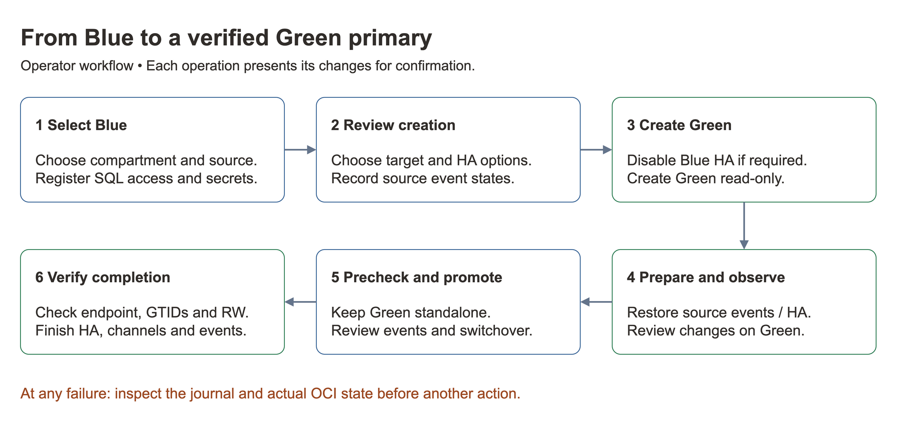
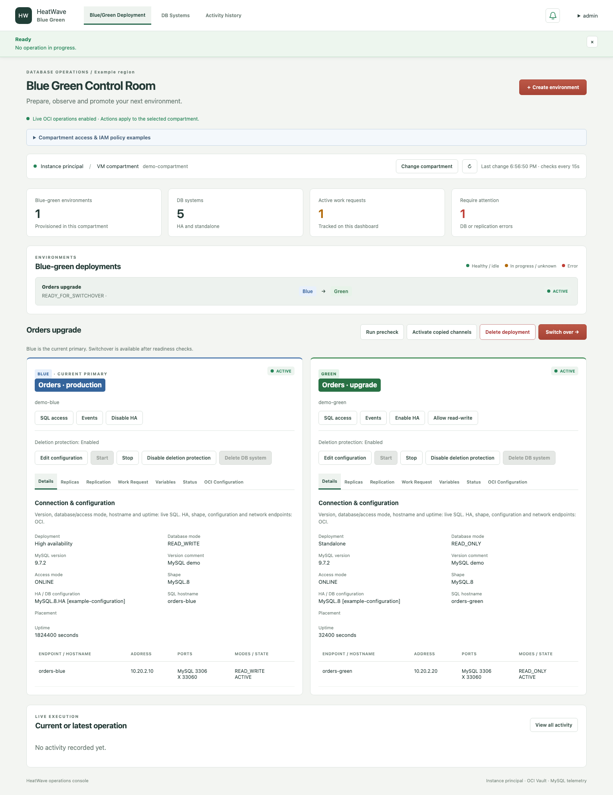
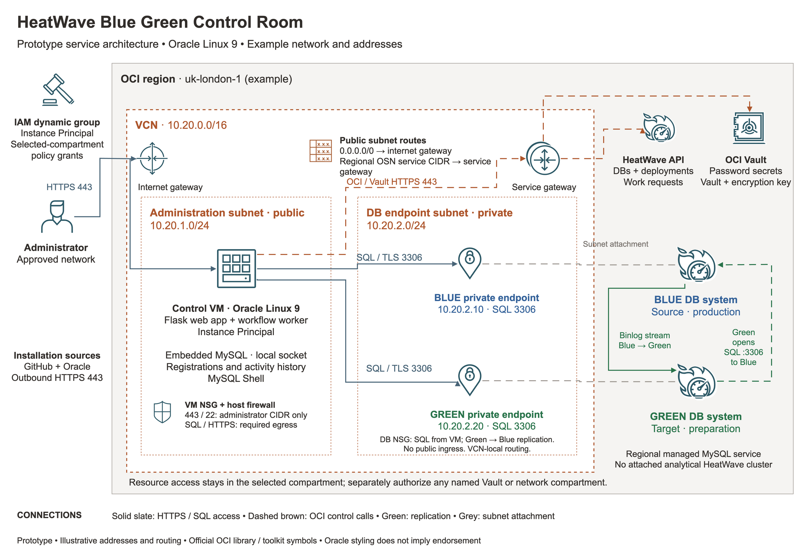
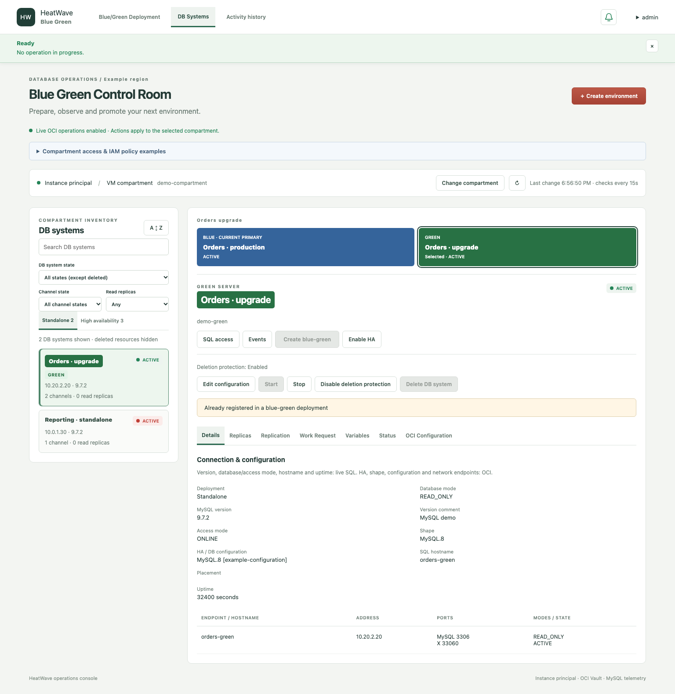
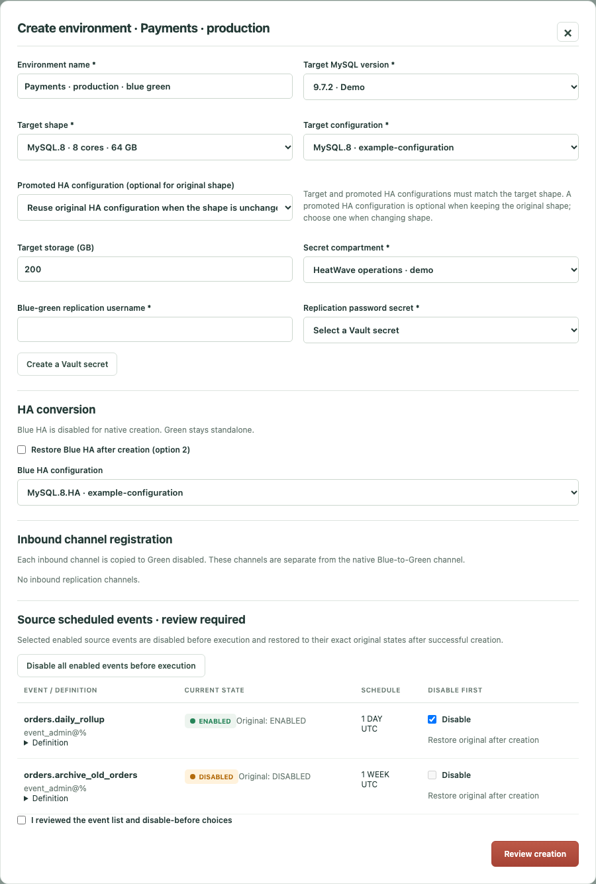
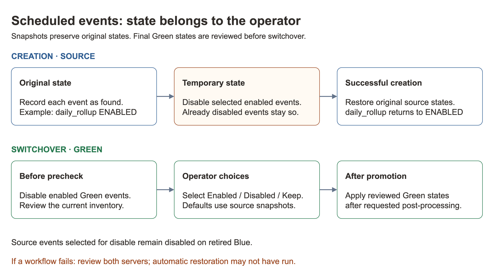
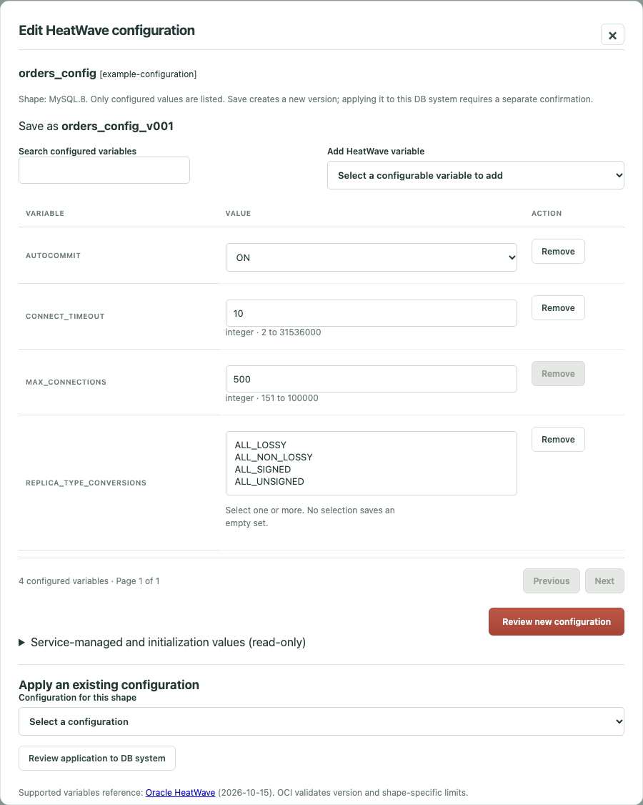
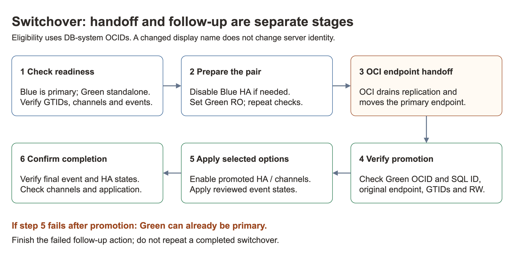

# Blue Green Control — User manual

**HeatWave Blue Green Control Room · Prototype · October 2026**

[Project overview](../README.md) · [HTML manual](user-manual.html) · [Technical guide](technical-guide.md)

## Contents

1. [Overview](#1-overview)
2. [Setup and installation](#2-setup-and-installation)
3. [Architecture](#3-architecture)
4. [Operation](#4-operation)
5. [Limitations](#5-limitations)

## 1. Overview

Blue Green Control helps an administrator prepare, observe and promote an **OCI MySQL HeatWave** DB system from one web application. Blue is the source; Green is the prepared target. The app coordinates OCI work requests, SQL observations, scheduled events and an execution journal.

Use it to rehearse a version or shape change, or prepare replication-compatible schema changes on Green while production continues on Blue. Examples include a large index build or an integer-column expansion. Apply schema changes through your SQL client; the application provides the preparation, configuration and switchover controls.

**Current primary** identifies the DB system serving the production endpoint. Blue/Green labels follow the registered DB-system OCIDs, even when OCI changes display names during switchover.



[Workflow diagrams (.drawio)](manual/operations.drawio)

Screens below show the current interface with **sample data**. Names, addresses, IDs and values are illustrative.



*The Blue/Green Deployment page keeps both servers and the current or latest operation together.*

## 2. Setup and installation

### Prerequisites

| Requirement | Prepare before installation |
| --- | --- |
| Compute | Oracle Linux 9 VM; `opc` login with sudo access. OL9 is the only tested platform. |
| Software | Git; Python 3.12 or newer, which setup installs if needed. Setup also installs application dependencies and app-local MySQL Server and MySQL Shell. |
| Network | Administrator access to HTTPS 443; VM access to both DB SQL endpoints, normally TCP 3306; outbound HTTPS and DNS for OCI, Vault, package repositories, GitHub and MySQL downloads. |
| OCI identity | A dynamic group containing the VM and policies scoped to the chosen resource compartments. No user API key is needed. |
| HeatWave | An eligible source DB system, capacity/quota for Green and any requested HA, and permission to use its subnet, NSGs and configuration. |
| SQL and secrets | Existing SQL accounts, passwords held in Vault secrets, and access to their secret compartment. The app does not create SQL users or grant privileges. |
| Operational preparation | A maintenance plan, tested database backups, and sufficient local disk for the embedded registration database and runtime packages. |

The observation account must see the required variables, status, replication information and scheduled events. Event administration needs `EVENT` privileges. Supply a replication account meeting the service requirements separately. Restricted event visibility can make an event list incomplete.

### Compartment-scoped IAM

The initial compartment is the VM's compartment. **Change compartment** selects another explicitly authorized compartment; it does not broaden the VM's permissions. Discovering a compartment name does not imply access to its DB systems.

An IAM administrator can match the VM using this dynamic-group rule:

```text
ALL {instance.id = '<compute-instance-ocid>'}
```

For discovery, use this grant:

```text
Allow dynamic-group <vm-group> to read mysql-family in compartment id <db-compartment-ocid>
```

For live operations, replace that MySQL grant with the following. The secret grants permit selecting existing secrets and retrieving their password values:

```text
Allow dynamic-group <vm-group> to manage mysql-family in compartment id <db-compartment-ocid>
Allow dynamic-group <vm-group> to read secrets in compartment id <secret-compartment-ocid>
Allow dynamic-group <vm-group> to read secret-bundles in compartment id <secret-compartment-ocid>
```

The existing-secret grants are also needed for SQL observation in discovery-only mode. Creating secrets additionally needs Vault/key permissions. DB provisioning needs the relevant subnet and NSG permissions. Grant these in their **specific owning compartments**; the application does not require tenancy-wide MySQL access. See [IAM examples](compartment-iam.html), [technical IAM details](technical-guide.md#compartment-scoped-iam) and [Oracle creation prerequisites](https://docs.oracle.com/en-us/iaas/mysql-database/doc/creating-blue-green-deployment.html).

### Install on Oracle Linux 9

Run as `opc`, from the VM:

```bash
sudo dnf install -y git
git clone https://github.com/ivanxma/HW_BLUE_GREEN_CONTROL.git bluegreen_control
cd bluegreen_control
./setup.sh --platform ol9 --mode https --port 443 --execute-oci
```

Setup selects the latest compatible MySQL Server and Shell packages available from the official download pages at installation time and checks their published checksums. The embedded MySQL instance stores registrations and activity; it is separate from the managed HeatWave DB systems.

For discovery-only evaluation, replace `--execute-oci` with `--read-only`. That mode permits observation and local registrations while blocking managed-resource and event changes. To enable execution later, rerun setup with `--execute-oci` during an idle maintenance window. Setup reruns preserve registrations and the changed administrator password, but restart services.

Setup opens the host firewall port. Configure the OCI NSG/security-list ingress separately, restricted to the administrator network. It generates a self-signed TLS certificate; use a trusted certificate for shared access. Certificate paths and other deployment settings are in protected `.runtime.env`; see the [technical setup guide](technical-guide.md#installation-and-configuration).

### First login and verification

1. Open `https://<compute-address>` from the allowed network.
2. Sign in as **admin** with initial password **`ChangeMe123!`**.
3. Change it immediately when prompted. Choose a different password of at least 12 characters, then sign in again.
4. Verify the region, selected compartment and execution-mode banner.
5. Open **DB Systems**, select a server and save its **SQL access** username, password secret and secret compartment. Green normally inherits Blue's saved profile.
6. Verify fresh SQL details and inspect **Events**, **Replication** and **Work Request** before creating an environment. An empty or inaccessible catalog must be resolved before it can supply required choices.

If the page is unavailable, check the services and network rules:

```bash
sudo systemctl status heatwave-bluegreen-local-mysql.service
sudo systemctl status heatwave-bluegreen-https.service
sudo journalctl -u heatwave-bluegreen-https.service -n 100 --no-pager
```

Protect the registration database and runtime settings with appropriate backups. Keep secrets, private keys, database files and operational reports out of source control.

## 3. Architecture



[Architecture (.drawio)](architecture/heatwave-control.drawio)

The diagram uses illustrative addresses and official OCI symbols. Oracle styling does not imply Oracle endorsement.

| Component | Role |
| --- | --- |
| Browser → Control VM | HTTPS interface for the administrator. |
| Flask app and one workflow worker | Coordinate reviewed actions, poll status and record execution steps. |
| Instance Principal | Authenticate the VM to OCI within the granted compartment scope. |
| OCI HeatWave service | Own the managed DB systems, native deployment, replication channels and work requests. |
| OCI Vault | Hold passwords used for SQL observation and replication registration. The local journal retains secret references. |
| SQL connections | Read actual version, access mode, hostname, uptime, GTIDs, variables and status; apply reviewed event changes. |
| Embedded MySQL | Store administrator authentication, registrations, plans, event snapshots and activity through a local Unix socket, with no TCP listener. |

The administration VM reaches the DB endpoints privately. Green initiates its replication connection to Blue; database changes flow from Blue to Green. Regional HeatWave and Vault services are outside the customer VCN, with private DB endpoint attachments inside the DB subnet. The [network table](technical-guide.md#architecture-and-network) describes gateways, routes and port rules. A private administration VM needs an appropriate private access and outbound route.

## 4. Operation

### Find a server and read its status

| Menu | Use |
| --- | --- |
| **Blue/Green Deployment** | Select an environment, compare Blue and Green, run precheck, switch over or delete the deployment. |
| **DB Systems** | Select a server from the left list; inspect it and administer it in the right panel. Standalone and HA lists are separate. |
| **Activity history** | Review recorded operations, UTC timestamps, step durations, choices, failures and work-request links. |

All DB states except deleted are shown by default. Search and filter by DB state, channel state or read-replica presence. Deleted DB systems, channels and deployments are hidden. A server with read replicas, or already belonging to a deployment, is excluded from new creation.

If **Create environment** is disabled, the explanation below it identifies any active operation and unavailable source DB systems. Expand **Source DB system eligibility** for each server's reasons. Creation requires an eligible ACTIVE source and no active application operation; the button updates automatically as these conditions change.



*Select the paired Blue or Green name above the details to switch to that server.*

| Detail tab | What it provides |
| --- | --- |
| **Details** | Connection, SQL version/mode, uptime, deployment type and configuration name with OCID. |
| **Replicas** | Read replicas associated with the selected DB system. |
| **Replication** | Channel state and health, source/target information, SQL replication and GTIDs. |
| **Work Request** | Paginated requests for the selected DB system and related deployment resources. |
| **Variables / Status** | Searchable, paginated tables collected through SQL. |
| **OCI Configuration** | Readable control-plane settings from OCI. |

Green status text means normal/idle; orange means work in progress or unverified health; red means failure. Blue/Green server-name highlights identify roles independently of status. Failures appear in the top banner and turn the notification icon red. Polling runs every 15 seconds and updates changed content while retaining selections. If SQL observation fails, affected values show **`*****`** until a successful check.

### Create an environment

1. Select the intended source, configure **SQL access**, then choose **Create blue-green** or **Create environment**.
2. Select the target MySQL version, shape and matching configuration. Keep target storage at least as large as Blue. The lists come from OCI.
3. Supply the replication username and Vault password secret. **Create a Vault secret** can create a password secret using the chosen compartment's vault and key when permissions allow.
4. For an HA source, review the required HA disable step. Select **Restore Blue HA after creation** if desired; Green stays standalone. A promoted HA configuration can reuse the original when the shape is unchanged; choose a matching one when changing shape.
5. Register credentials for existing inbound channels. The app copies these to Green disabled and keeps their names distinct from the native channel.
6. Review every source event, select which enabled events to disable temporarily, and acknowledge the review. Review is required even if the list is empty.
7. Choose **Review creation**. Read the listed OCI/SQL changes and confirm. Follow the top banner, current operation and work requests until completion.



*The review records chosen secrets and event states before execution.*

Successful creation leaves Green read-only, restores the source's original event states, and restores Blue HA only when selected. Confirm healthy native replication and disabled copied channels. In live mode, the background monitor can disable a channel after freshly confirming it is unhealthy; unknown health alone is insufficient. Repair or deliberately remove an unhealthy channel before relying on it.

### Manage scheduled events



Creation records an event snapshot. If `daily_rollup` was enabled and you select **Disable all enabled events before execution**, it is disabled temporarily and enabled again after successful creation. An event already disabled remains disabled. Replica-side-disabled states are preserved where no local alteration is needed.

For switchover, first use Green's **Events** control to disable enabled events; the precheck requires this. In the switchover dialog, select source events to disable and Green's final states: **Enabled**, **Disabled** or **Keep current**. Defaults use recorded original source states when available. Selected disabled source events stay disabled on the retired source; Green receives the reviewed final states after successful promotion and post-processing.

If the event list changes, reopen and review it. Disabling an event does not stop an invocation already running. If creation or switchover fails, inspect the journal and both servers' actual event states; completion-time restoration may not have run.

### Prepare changes on Green

1. Confirm native replication is healthy and production writes still go to Blue.
2. Select **Allow read-write** on Green and review the conversion guidance. **Review Green configuration first** opens the relevant setting without changing it automatically.
3. Apply reviewed schema changes with your SQL client. Observe replication errors, lag, capacity and application behavior before proceeding.
4. Keep other inbound Green channels disabled. Disable enabled Green events before precheck. Switchover returns Green to read-only for the handoff.

| `replica_type_conversions` choice | Meaning |
| --- | --- |
| Empty | No attribute promotion/demotion. |
| `ALL_NON_LOSSY` | Permit supported widening conversions. |
| `ALL_LOSSY` | Permit supported narrowing conversions that can lose data. |
| `ALL_SIGNED` / `ALL_UNSIGNED` | Control signedness for integer promotion when combined with conversion options. |

For a reviewed `INT` → `BIGINT UNSIGNED` change, `ALL_NON_LOSSY,ALL_UNSIGNED` may be appropriate; validate value ranges and the complete schema first. Conversion settings do not make arbitrary table differences compatible. See [MySQL attribute-promotion rules](https://dev.mysql.com/doc/refman/9.7/en/replication-features-differing-tables.html#replication-features-attribute-promotion) and [schema preparation details](technical-guide.md#preparing-schema-changes-on-green).

### Change a DB configuration

1. Choose **Edit configuration** for the intended DB system. Search the configured values or add a documented HeatWave variable.
2. Change values using the offered controls. Enumerations, Booleans, sets and flags have selections. Service-managed and initialization values are read-only.
3. Choose **Review new configuration**, review the plan and confirm. Saving creates `[original_name]_v###`, for example `orders_config_v001`, without modifying the original.
4. After saving, choose **Review application to DB system** or **Keep saved · apply later**. Application has a separate confirmation and can restart the DB system. You can also select a saved matching configuration in the editor.
5. After the work request succeeds, verify effective SQL values in **Variables**.



*Removing an optional variable requires acknowledgement: omission does not reset a persisted value on an existing DB system. Prefer changing its value. Required variables cannot be removed.*

Configurations must match the DB shape and HA requirements. OCI validates the final request. See [Oracle configuration variables](https://docs.oracle.com/en-us/iaas/mysql-database/doc/configuration-variables.html).

### Run precheck and switch over

The **Switch over** button is available only while Blue is the current primary and the deployment has not already switched over. A visible button is not proof that every readiness check will pass.

1. Disable enabled Green events and all inbound Green channels except the native Blue-to-Green channel.
2. Choose **Run precheck**. Both DBs must be active; Green must be standalone; native replication must be enabled and healthy. Blue may have transactions still to replicate. Additional Green GTIDs are accepted only under Green's own server UUID; other unexpected GTIDs fail.
3. Choose **Switch over**. Review source and target event choices, replication-drain wait, optional HA on promoted Green, and optional activation of copied channels. A blank HA override reuses a compatible registered/original configuration.
4. Choose **Review switchover**, read the changes and confirm. Allow for client disconnections during the endpoint handoff.
5. Follow the operation through final verification and all requested post-processing. Check the current-primary OCID, endpoint, read-write state, GTIDs, events and any HA/channel changes before declaring completion.



The app disables Blue HA when needed, makes Green read-only, repeats readiness checks and invokes native OCI switchover. It then checks that the original primary endpoint reaches the promoted Green identity, includes Blue's final GTIDs and permits writes. Names may swap; OCIDs and SQL identity are used for verification. Extra local Green GTIDs are highlighted for review. [Oracle switchover behavior](https://docs.oracle.com/en-us/iaas/mysql-database/doc/switching-over-blue-green-deployment.html).

**If handoff succeeds but enabling HA, channels or events fails, Green may already be primary.** Inspect the successful handoff and verification steps, then finish the failed follow-up action on that DB system. Do not attempt another switchover as recovery.

### HA and lifecycle controls

**Enable HA** lists compatible configuration names and OCIDs for the selected DB shape. The current compatible HA configuration is preselected. **Disable HA** also requires review. Schedule these changes knowing they affect availability.

| Action | Conditions and effect |
| --- | --- |
| **Start** | Available for an inactive DB system. Review the target and start it. |
| **Stop** | Available for an active DB system. Confirmation is required; the app requests FAST shutdown. |
| **Disable deletion protection** | Separate confirmed change. Refresh until OCI verifies protection is disabled. |
| **Delete DB system** | Available only in an allowed settled state with protection verified disabled. Confirm the exact DB OCID and review the backup policy; this deletes the selected database resource. |
| **Delete deployment** | Removes only the native deployment record after confirmation. It does not delete either DB system, their data, backups or existing channels. |

Deleting a deployment does not clean up its retained resources or their charges. The native replication channel is normally removed by OCI after completed switchover; deployment deletion does not restore it. [Oracle deployment-management behavior](https://docs.oracle.com/en-us/iaas/mysql-database/doc/managing_a_blue_green_deployment.html).

### Troubleshooting and interrupted operations

| Symptom | Next step |
| --- | --- |
| Access warning after changing compartments | Check the selected compartment, dynamic-group membership and grants for that compartment. A `404 NotAuthorizedOrNotFound` can mean missing permission or a missing resource; do not assume tenancy-wide access is needed. |
| `*****` in observed values | Verify the SQL profile, secret access, network route/NSG, port and TLS settings. Wait for a successful SQL check. |
| Replication health unknown | Choose **Replication → Refresh snapshot** and confirm the diagnostic action. It generates a current OCI health snapshot and records the work request, without changing replication or DB configuration. Snapshots expire after 12 hours; absence alone does not establish a fault. If generation is denied, check channel permissions in the selected compartment. [Oracle channel-status behavior](https://docs.oracle.com/en-us/iaas/mysql-database/doc/viewing-replication-channel-status.html). |
| Precheck fails | Read the failed step: check primary OCID, lifecycle, HA, native channel, other channels, events and unexpected GTIDs. |
| Diagnostic details unavailable for a work request | Use the actual work-request status. An unavailable diagnostic section does not itself make the operation fail. |
| Operation fails or is interrupted | Open **Activity history**, record the step and OCI request/work-request IDs, then inspect current OCI state before retrying. Submitted work may still be running. |
| Confirmation expires or state changes | Refresh the resource, reopen the action and review a new plan. |

Do not run setup or restart the application while a workflow is active. A restart marks its local job interrupted; it does not cancel the OCI request. The application does not automatically roll back completed steps. Preserve snapshots and reconcile HA, channels and events before starting another operation.

## 5. Limitations

| Area | Boundary |
| --- | --- |
| Prototype | Intended for evaluation and rehearsed advanced operation. It is not an Oracle-supported product or a production certification. OL9 is the only tested platform. |
| Native service scope | Native Blue/Green requires same-region standalone DB systems. HA, cross-region, attached HeatWave clusters, MySQL REST Service and Always Free have service exclusions. The app also blocks creation with read replicas. |
| HA sequencing | Disabling and restoring HA does not make native Blue/Green an HA-supported operation. Standalone intervals reduce availability. |
| Schema changes | GTID and replication checks do not prove schema/application compatibility or data equivalence. DDL execution and application testing remain the operator's responsibility. |
| Event recovery | Original states are restored on successful creation. Failure can leave temporary states requiring reconciliation. Final Green event states are operator choices. |
| Concurrency | All mutations use Standard OCI requests, without ETag/If-Match. Fresh state checks reduce stale actions but are not an atomic lock against another client. Avoid concurrent external administration. |
| Recovery | No automatic rollback, reverse switchover or replay of interrupted workflows. A later failure may follow a successful promotion. |
| Control application | Run one worker on one control VM. Protect its embedded registration store; control-VM or store availability affects administration and history. |
| Authorization and catalogs | Listings and operations depend on current IAM, service limits and version/shape compatibility. The variable catalog is not the full MySQL variable set. |

Native scope is described in [Oracle Blue/Green documentation](https://docs.oracle.com/en-us/iaas/mysql-database/doc/blue-green-deployments.html). Implementation and recovery details are in the [technical guide](technical-guide.md); historical conditional-update findings are in [ETag usage and removal](etag-usage.md).
